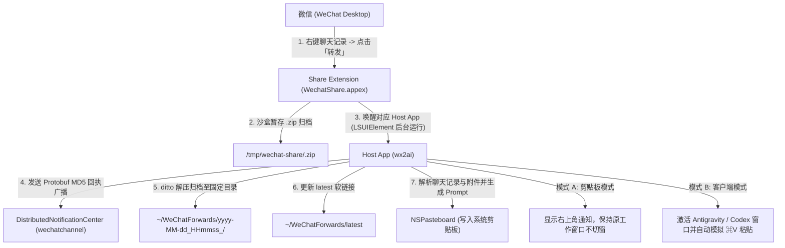

# wx2ai — macOS 微信「转发到其他应用」桥接工具 (Clipboard / Antigravity / Codex)

[](https://apple.com/macos)
[](https://swift.org)
[](LICENSE)

**wx2ai** 是一个专为 macOS 设计的**零侵入、原生 Share Extension 桥接套件**。它基于 macOS 标准 `NSExtension` (`com.apple.share-services`) 与 `public.zip-archive` UTI 规范，将 **「转发到剪贴板」**、**「转发到 Antigravity」** 以及 **「转发到 Codex」** 优雅注入微信（Mac 版）的「转发到其他应用 -> 选择电脑中的应用」菜单。

无需 Hook 微信、无需注入动态库，原生实现**一键转发聊天记录与附件、自动解压归档、智能组装 Markdown Prompt，并支持自动粘贴至 AI 窗口**！

---

## 💡 初衷与背景 (Motivation)

在日常开发与团队协作中，大量的需求讨论、Bug 截图、日志文件以及上下文散落在微信聊天记录（单聊或群聊合并转发）中。macOS 微信桌面端提供了「转发 -> 转发到其他应用」功能，可将选中的多条消息打包给本地桌面应用。

然而存在几个痛点：
1. **默认不支持主流 AI Coding 工具**：日常主力使用的 **Antigravity**（`com.google.antigravity`）与 **Codex 桌面版**（`com.openai.codex`）未声明针对微信分享导出的 `.zip` 格式的系统扩展，无法在列表内显示。
2. **拒绝高危注入与越狱改包**：修改微信二进制或注入 dylib 不仅微信每次更新都会失效，还会破坏 macOS 代码签名及 TCC 隐私授权。
3. **用户体验优先**：如果每次转发还要手动切换窗口、手动按 `⌘V`，流程依然繁琐；若能**直接复制到剪贴板（不抢焦点）**，或**切回已有 AI 会话自动粘贴**，才是真正流畅的生产力闭环。

**wx2ai 的设计原则**：
- **零侵入微信本体**：完全基于 macOS 原生 `com.apple.share-services` 扩展规范，微信原生地识别并展示候选应用。
- **图文与附件全量提取**：自动解压到本地固定归档目录（`~/WeChatForwards/`），完整提取聊天文本与图片、PDF、文档等附件路径。
- **灵活的交互模式**：提供「纯剪贴板模式」（不切窗口、不抢焦点）与「客户端自动粘贴模式」（自动切窗、聚焦后合成 `⌘V`）。

---

## 🌟 核心原理与架构 (How It Works)



### 核心流程剖析
1. **微信打包与唤醒**：微信将选中的聊天记录打包成临时 `.zip`，调用 `WechatShare.appex`。
2. **提取 `.zip`**：沙盒内的 `WechatShare.appex` 从 `NSItemProvider` 提取数据（兼容原生 `URL`、二进制 `PK` 字节流，以及 AppKit 传递的 UTF-8 `file://` URL `Data`）。
3. **Protobuf 状态回执**：宿主程序计算 `.zip` 标准路径的 32 位大写 MD5，组装为 Protobuf 编码格式（`08 03 2a 20 <MD5>`）并 Base64 编码，通过 `DistributedNotificationCenter` 向对应频道的通知中心广播 Ack。
4. **Prompt 组装**：自动识别 `聊天记录.txt`（支持 UTF-8 与 GB18030 编码），按相对路径归类附件，并组装结构化 Markdown Prompt。

---

## 📦 三大转发模式

| 应用包名 | 显示名称 | 工作流特点 | 适用场景 |
| :--- | :--- | :--- | :--- |
| **`WeChatToClipboard.app`** | **转发到剪贴板** | **纯后台运行**，生成 Prompt 存入剪贴板并弹通知，**不切窗、不抢焦点** | 随时按 `⌘V` 粘贴到浏览器、飞书、文档或任意 AI 客户端 |
| **`WeChatToAntigravity.app`** | **转发到 Antigravity** | 激活 Antigravity 当前窗口，等待输入框聚焦后**自动模拟 `⌘V` 粘贴** | 直接在 Antigravity 当前 Thread 中开始对话 |
| **`WeChatToCodex.app`** | **转发到 Codex** | 激活 Codex / ChatGPT 当前窗口并自动粘贴；或通过 DeepLink 新建会话 | 与 ChatGPT / Codex 深度集成 |

---

## 🚀 快速开始 (Quick Start)

### 1. 克隆代码与构建

```bash
git clone https://github.com/bilppppp/wx2ai.git
cd wx2ai

# 编译所有二进制产物并完成代码签名
./build.sh
```

> **分发说明**：本项目仅分发开源源代码，Git 仓库中**不包含**任何第三方应用的专有图标二进制。编译脚本在未检测到本地应用图标时，会自动安全回退到 macOS 系统的通用应用图标，确保从源码构建始终平滑成功。

### 2. 一键安装到系统

```bash
./install.sh
```

`install.sh` 脚本将自动完成：
- 将三款应用安装至 `/Applications/`（或 `~/Applications/`）；
- 调用 `lsregister -f` 强制刷新 LaunchServices 系统服务注册表；
- 调用 `pluginkit -a` 注册内嵌的 Share Extension；
- 调用 `pluginkit -e use` 启用系统扩展；
- 运行测试探针校验并打印当前系统生效的 `.zip` 分享服务。

---

## 💬 使用指南 (Usage)

1. 在微信电脑端中，按住 `Shift` 或多选若干条聊天记录。
2. 鼠标右键点击所选记录，选择 **「转发」**。
3. 在弹出的分享列表中选择：
   - **「转发到剪贴板」**（推荐）：不改变当前工作窗口，右下角提示后，随时在任何窗口按 `⌘V` 粘贴。
   - **「转发到 Antigravity」** 或 **「转发到 Codex」**：自动唤起目标窗口，等待输入框聚焦后自动完成 `⌘V` 粘贴。
4. 所有转发历史记录均安全保存在 `~/WeChatForwards/` 中，`~/WeChatForwards/latest` 永远指向最新记录。

### 权限设置说明
- **分享菜单扩展显示**：若微信分享菜单未出现选项，请打开 macOS **「系统设置」->「隐私与安全性」->「扩展」->「分享菜单」**，确保勾选了 **转发到 Antigravity**、**转发到 Codex** 或 **转发到剪贴板**。
- **免按 `⌘V` 自动粘贴权限**：若使用客户端模式的自动粘贴功能，系统需要「辅助功能」权限。可直接打开 `/Applications/WeChatToAntigravity.app` 或进入 **「系统设置」->「隐私与安全性」->「辅助功能」** 授予权限；若未授权，系统会自动降级为剪贴板模式并弹窗提示手动按 `⌘V`。

---

## 📋 剪贴板生成的 Prompt 格式示例

````markdown
# 微信转发聊天记录

- **解压目录**: `/Users/<username>/WeChatForwards/2026-10-29_144324_791e`
- **最新记录软链接**: `/Users/<username>/WeChatForwards/latest`
- **聊天记录文本文件**: `/Users/<username>/WeChatForwards/2026-10-29_144324_791e/聊天记录.txt`
- **附件列表** (2 个):
  - `/Users/<username>/WeChatForwards/2026-10-29_144324_791e/attachment1.png`
  - `/Users/<username>/WeChatForwards/2026-10-29_144324_791e/subfolder/document.pdf`

## 聊天记录内容

```text
张三: 转发到剪贴板测试
李四: 收到，请分析附件中的需求文档
```

请根据以上微信转发的聊天记录及附件进行分析和处理。
````

---

## ⚠️ 注意事项：转发文件的存储本质与清理逻辑 (File Storage & Cleanup Notes)

在使用本桥接工具时，生成的 Prompt 顶部会带有 `解压目录` 与 `最新记录软链接`，关于存储与清理的说明如下：

1. **这些文件是转发时导出的独立副本，绝非微信内部原文件引用**：
   - 微信客户端内部将聊天文字存储在加密的 SQLite 数据库中，图片与媒体文件采用专有格式存放，外部应用无法直接通过路径读取微信内部私有库。
   - 当你在微信点击「转发到其他应用」时，**微信客户端会临时将选中的消息和附件解密导出，打包生成一个新的 `.zip` 压缩包**传给系统分享扩展。
   - 桥接程序将 `.zip` 解压至 `~/WeChatForwards/<时间戳_随机码>/`，以便当聊天记录包含**图片、PDF、代码或超长文本**时，Antigravity / Codex 能通过本地绝对路径直接读取并解析这些多模态文件。
2. **清理逻辑与安全性**：
   - **中转 `.zip`（`$TMPDIR/wechat-share/`）**：位于 macOS 临时目录，系统会在重启或周期性维护时自动回收。
   - **解压归档目录（`~/WeChatForwards/`）**：默认保留历史转发文件，每次转发生成一个时间戳子文件夹，并更新快捷软链接 `~/WeChatForwards/latest`。
   - **100% 安全可删**：删除 `~/WeChatForwards/` 下的任何文件**绝不会影响微信内的原始聊天记录**。如需释放磁盘空间，可随时安全执行：
     ```bash
     rm -rf ~/WeChatForwards/*
     ```

---

## 📁 项目目录结构 (Project Structure)

```
wx2ai/
├── Sources/
│   ├── ShareExtension/
│   │   └── ShareViewController.swift    # 分享扩展核心入口，提取微信传递的 zip 并唤起 Host App
│   ├── HostApp/
│   │   └── main.swift                   # Host App 入口，解压、Ack、生成 Prompt、自动粘贴/剪贴板模式
│   └── check_share_services.swift       # 探针工具，列出系统当前生效的 .zip 分享服务
├── Config/
│   └── ShareExtension.entitlements      # 分享扩展 App Sandbox 与只读授权配置
├── dist/                                # 编译生成的最终 .app 产物 (由 build.sh 生成，已忽略)
│   ├── WeChatToAntigravity.app
│   ├── WeChatToCodex.app
│   └── WeChatToClipboard.app
├── build.sh                             # 自动化构建、组装、签名与验证脚本
├── install.sh                           # 一键安装到 /Applications 并注册 LaunchServices & PlugInKit
├── .gitignore                           # Git 忽略配置
├── GUIDE.md                             # 深入技术背景与设计文档
├── LICENSE                              # 开源许可证
└── README.md                            # 项目官方说明文档
```

---

## ⚖️ 免责声明 (Disclaimer)

1. 本项目仅调用 macOS 官方公开的 `Share Extension` / `NSSharingService` 接口处理用户主动导出的文件，不修改、不注入、不破解任何第三方软件客户端；
2. WeChat、微信、WorkBuddy、Antigravity、Codex 等商标归各自权利人所有，本项目与腾讯、Google、OpenAI 无任何官方关联；
3. 用户在将聊天记录及附件转发至第三方 AI 服务前，应自行审慎评估数据隐私与商业秘密合规要求。

---

## 📄 License

MIT License. See [LICENSE](LICENSE) for details.
